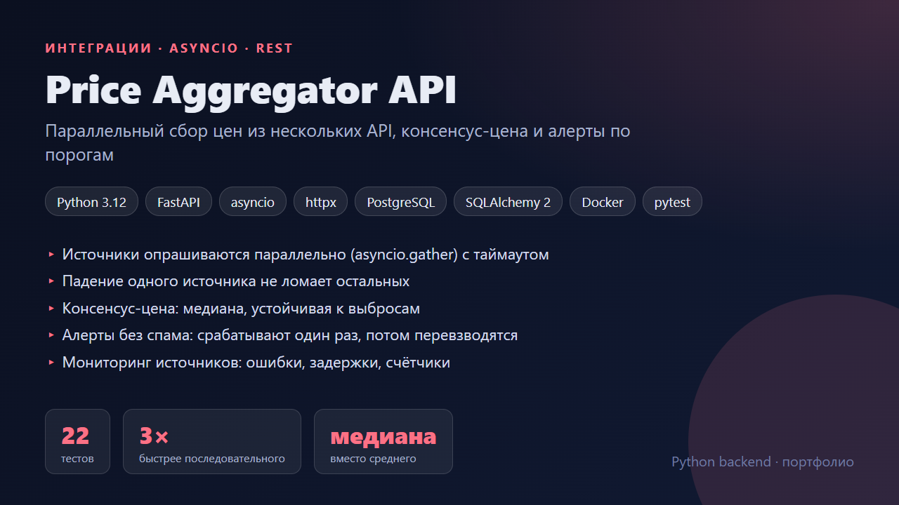
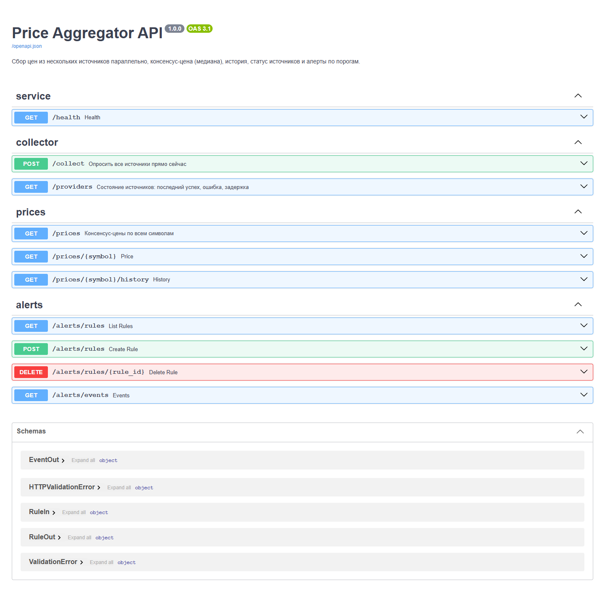
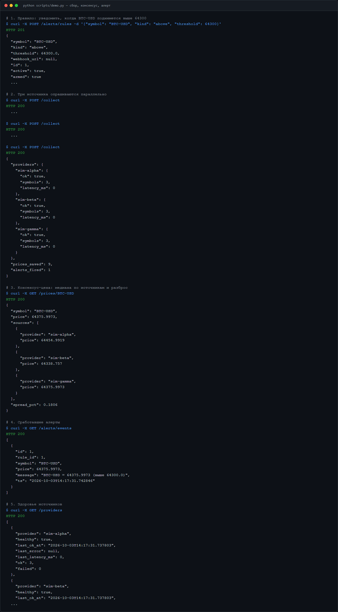
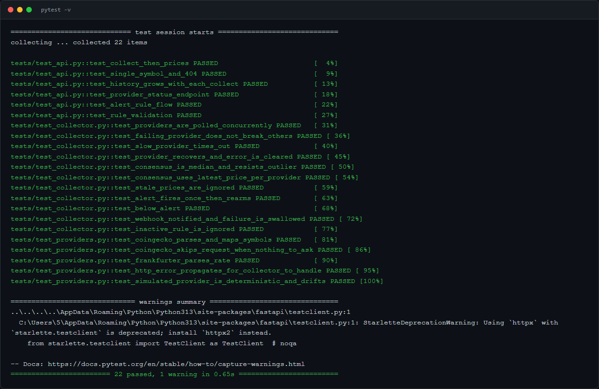

# Price Aggregator API

Сервис собирает цены (крипта, валюты) из нескольких независимых источников, считает надёжную консенсус-цену, хранит историю и сообщает о выходе цены за порог.



## Как это работает

```
          ┌─ CoinGecko ──┐
 collect ─┼─ Frankfurter ┼─ asyncio.gather + timeout ─> prices (история) ─> consensus (медиана) ─> alerts
          └─ ...  ───────┘            └─> provider_status (успех / ошибка / задержка)
```

| Задача | Решение |
|---|---|
| Много медленных источников | Опрос параллельный, `asyncio.gather` с таймаутом на каждый. Три источника по 0,4 с опрашиваются за ~0,4 с, а не за 1,2 с (проверено тестом) |
| Источник упал или завис | Ошибка фиксируется в `provider_status`, остальные источники и расчёт не страдают |
| Один источник дал мусор | В консенсусе берётся медиана последних свежих цен, а не среднее. Выброс не двигает цену |
| Устаревшие данные | Цены старше 15 минут в консенсус не попадают |
| Алерты не должны спамить | После срабатывания правило «разряжается» и снова взводится, когда цена вернулась по другую сторону порога |
| Вебхук алерта недоступен | Событие всё равно сохраняется, сбор не падает |

Источники подключаются через простой контракт `async fetch(symbols) -> {symbol: price}`. Для нового API нужно написать один класс. Для демо и тестов есть `SimulatedProvider`, а реальные `CoinGeckoProvider` и `FrankfurterProvider` покрыты тестами на моках HTTP.

## Запуск

```bash
docker compose up --build        # PROVIDERS=live, сбор раз в минуту, http://localhost:8000/docs
```

```bash
pip install -r requirements.txt
PROVIDERS=simulated uvicorn app.main:app --reload
python scripts/demo.py
pytest
```

Переменные: `PROVIDERS` (`live` или `simulated`), `POLL_SECONDS` (0 — только ручной `POST /collect`), `SYMBOLS`, `DATABASE_URL`.

## Скриншоты

| Swagger | Демо-сценарий | Тесты |
|---|---|---|
|  |  |  |
